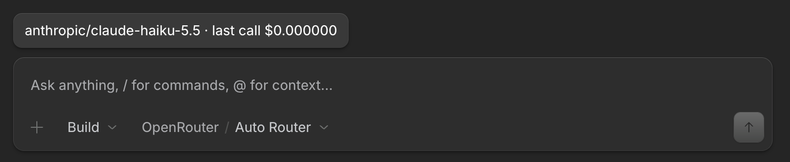

# OpenCode Show Auto Router Model

An OpenCode plugin that shows which model OpenRouter actually used when you pick a router model such as Auto Router. The Desktop pill above the composer shows the routed model and the cost of the last completed assistant call, when available. The terminal footer shows the routed model and session cost.



## Compatibility

Tested with OpenCode Desktop 2.4.2 and `@opencode/plugin` 2.4.1.

## Installation

Requires OpenCode with the experimental GUI plugin API and an OpenRouter connection. Clone this repository, then run:

```sh
npm ci
npm run build
```

Add the absolute path to the cloned directory to the `plugins` array in your global `~/.config/opencode/opencode.json`. Select an OpenRouter router model such as `openrouter/openrouter/auto` and send a message. The plugin starts automatically; the pill appears once a routed model is detected.

## Development

```sh
npm run build
npm test
```

The GUI bundle in `dist/` is required by OpenCode Desktop. Rebuild it after editing `gui.tsx`.

## Limitations

- The Desktop GUI API is experimental. The pill's wrapping style targets internal Desktop markup (`data-slot="session-plugin-pill"` and its `aria-label`), so any OpenCode update may break it; long names then truncate again.
- The displayed model is the latest detected primary response, not a history of models used. It is kept in memory and is lost when the OpenCode server restarts.
- Desktop cost is the amount stored by OpenCode for the last completed assistant call, not the total for an entire user turn that may contain multiple calls. OpenCode may calculate the amount when the provider does not report it. The terminal footer shows session cost instead.

## License

MIT
